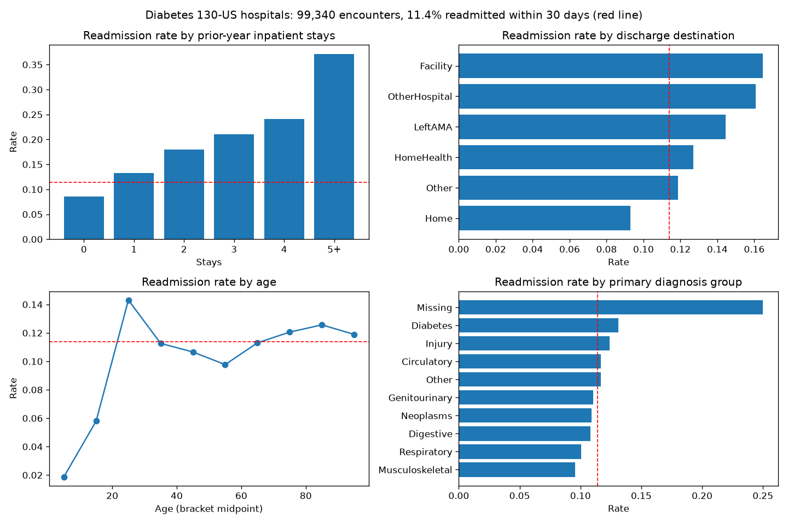
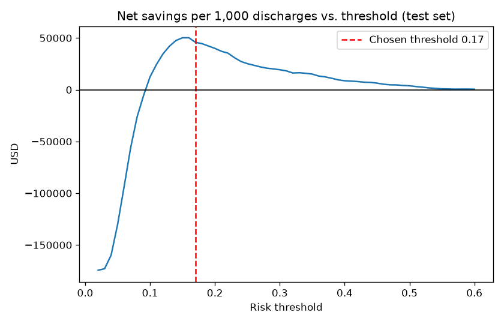
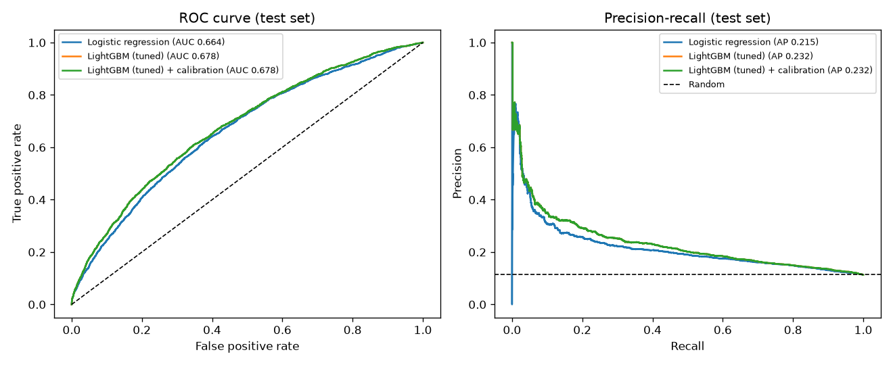
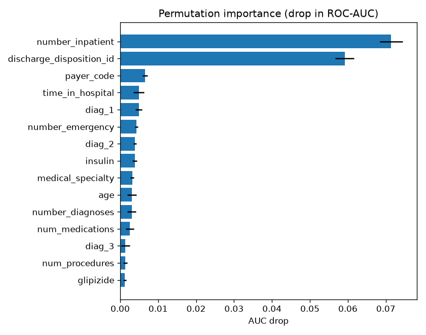

# 🏥 Predicting 30-Day Hospital Readmission for Diabetic Patients

An end-to-end machine-learning system that flags diabetic patients at high risk of
being readmitted within 30 days of discharge, so hospitals can target follow-up care.
It covers the whole path from raw data to a tested, deployable API and web app.


## The problem

About **1 in 9** diabetic inpatients in this data comes back within 30 days. Readmissions are
expensive (≈ $15k each) and in the US, Medicare's *Hospital Readmissions Reduction Program*
fines hospitals with high rates. Hospitals can lower readmissions with transitional care
(follow-up calls, medication reconciliation, early clinic visits), but cannot afford to give it
to everyone. **The question:** at discharge, who should get it?

## Results (held-out test set: 19,773 encounters from patients never seen in training)

| Metric | Value |
|---|---|
| ROC-AUC | **0.678** (published work on this dataset reports ~0.65–0.70) |
| PR-AUC | 0.232 (random = 0.113, so 2× better) |
| Top-10% lift | **2.41×** (the riskiest 10% are readmitted 2.4× more often than average) |
| Calibration (Brier) | 0.0955, predicted risks match observed rates |
| Decision threshold | 17% risk (chosen to maximise net savings) |
| Patients flagged | 15% of discharges |
| Readmissions caught | 32% of all readmissions |
| **Estimated net savings** | **≈ $45,800 per 1,000 discharges** |

For comparison, giving the programme to *everyone* **loses** ≈ $174,000 per 1,000 discharges.
The model makes the programme pay for itself by choosing who gets it.

> Savings rest on stated assumptions in [`config.yaml`](config.yaml): $15,000 per readmission,
> $600 per intervention, and the intervention prevents 25% of readmissions it reaches.
> Change them and the threshold is re-optimised on the next run.

| | |
|---|---|
|  |  |
|  |  |

**What drives risk:** prior-year inpatient stays (8% → 37% readmission as they go from 0 to 5+)
and discharge destination (patients sent to nursing facilities are readmitted far more often than those sent home)
dominate. Length of stay, primary diagnosis, emergency visits and insulin changes add smaller signals.

## How it works

```
data/raw (UCI CSV) ─► clean ─► patient-grouped split ─► features ─► model search ─► calibration ─► cost-based threshold ─► test report
                                                                                                         │
                                                                    models/model.joblib ◄────────────────┘
                                                                         │
                                               FastAPI  (api/main.py)  ◄─┴─►  Streamlit app (app/streamlit_app.py)
```

1. **Data** ([`data.py`](src/readmission/data.py)): the [UCI Diabetes 130-US Hospitals](https://archive.ics.uci.edu/dataset/296)
   dataset (101,766 encounters, 1999–2008). Removes encounters ending in death or hospice (they can't be readmitted).
2. **Leak-free split**: 16k patients have several encounters. Splitting by *patient* (`GroupShuffleSplit`)
   makes sure the test set contains only people the model has never seen. A row-level split would inflate the scores.
3. **Features** ([`features.py`](src/readmission/features.py)): ICD-9 codes grouped into disease families, utilisation totals,
   medication counts and up/down changes, lab-test flags, per-day intensity ratios, grouped admission/discharge codes.
   All inside one scikit-learn transformer, so training, the API and the app use identical logic.
4. **Models** ([`train.py`](src/readmission/train.py)): a prior-rate baseline, logistic regression, and LightGBM tuned with
   25-candidate random search over patient-grouped 4-fold CV. Picked by validation PR-AUC.
5. **Calibration**: sigmoid calibration on the validation set, so "20% risk" really means about 20%.
6. **Business threshold**: picks the cut-off that maximises expected savings, instead of the default 0.5.
7. **Evaluation** ([`evaluate.py`](src/readmission/evaluate.py)): test-set metrics, lift, calibration plot,
   permutation importance, and a **fairness check** of AUC and recall by race, gender and age.

### Fairness notes
Performance is similar across gender (AUC 0.686 F / 0.669 M) and the larger race groups
(0.671 African American / 0.676 Caucasian). It is weaker for the oldest patients (90+: AUC ≈ 0.50, recall 16%),
so the model should not be the only screen for that group. See [`reports/fairness_test.csv`](reports/fairness_test.csv).

### Limitations
- The data is from 1999–2008 US hospitals; any real deployment would need retraining and validation on local data.
- It has no social factors (housing, caregiver support, follow-up access), which are known readmission drivers. This caps AUC.
- Savings are an estimate based on the assumptions above, not a measured trial result.
- Decision support only: clinicians stay in the loop.

## Project structure

```
├── config.yaml              # data URL, split sizes, tuning budget, business assumptions
├── src/readmission/
│   ├── data.py              # download, clean, patient-grouped split
│   ├── features.py          # feature engineering transformer + preprocessing
│   ├── eda.py               # exploratory analysis figure
│   ├── train.py             # full training pipeline
│   ├── evaluate.py          # metrics, savings, fairness, plots
│   └── predict.py           # load model + score
├── api/main.py              # FastAPI service (/predict, /predict/batch, /health, /model-info)
├── app/streamlit_app.py     # web app for discharge staff
├── models/                  # trained model (250 KB) + metadata
├── reports/                 # metrics, fairness, importance, figures
├── tests/                   # unit + API tests (pytest)
├── Dockerfile               # container for the API
└── .github/workflows/ci.yml # runs tests on every push
```

## Run it

```powershell
# Windows, one command: setup, EDA, training, tests
powershell -ExecutionPolicy Bypass -File run_all.ps1
```

Or step by step (any OS):

```bash
python -m venv .venv && source .venv/bin/activate   # Windows: .venv\Scripts\activate
pip install -r requirements.txt && pip install -e .
python -m readmission.eda       # downloads data, writes reports/figures/eda_overview.png
python -m readmission.train     # ~10 min on a laptop; writes models/ and reports/
pytest -q
```

**API**
```bash
uvicorn api.main:app            # docs at http://127.0.0.1:8000/docs
curl -X POST http://127.0.0.1:8000/predict -H "Content-Type: application/json" \
  -d '{"age":"[70-80)","number_inpatient":3,"discharge_disposition_id":3,"diag_1":"428","time_in_hospital":8}'
# {"readmission_risk":0.292,"flag_for_followup":true,"risk_band":"high","threshold":0.17}
```

**Web app**
```bash
streamlit run app/streamlit_app.py
```

**Docker**
```bash
docker build -t readmission-api . && docker run -p 8000:8000 readmission-api
```

## Data source & citation
Strack, B. et al. (2014). *Impact of HbA1c Measurement on Hospital Readmission Rates: Analysis of 70,000
Clinical Database Patient Records.* BioMed Research International. Data: UCI Machine Learning Repository, CC BY 4.0.
